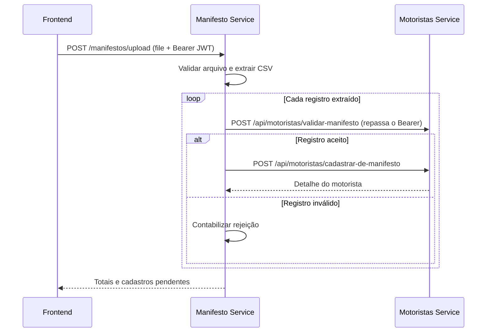

# NEWELOG | manifesto-service

> Projeto Integrador 3º Semestre · DSM · FATEC São José dos Campos · Equipe **Koitech-Log** · Cliente **NEWE Logística Integrada**
>
> [Repositório principal](https://github.com/Koitech-Log/Koitech-Log-3DSM-Newelog) · [Documentação do projeto](https://github.com/Koitech-Log/Documentos) · [motoristas-service](https://github.com/Koitech-Log/newelog-motoristas-service) · [auth-service](https://github.com/Koitech-Log/newelog-auth-service) · [frontend](https://github.com/Koitech-Log/newelog-frota-web)

Microsserviço de **importação de arquivos CSV** do NEWELOG. Recebe o upload, valida e lê o arquivo, e envia os registros ao `motoristas-service`, que faz a persistência.

| Sprint | Funcionalidade | Rota |
| :--- | :--- | :--- |
| 1 | Upload do manifesto: vincula as viagens aos motoristas e sinaliza motoristas com cadastro pendente (US02) | `POST /manifestos/upload` |
| 2 | Upload de CSV de veículos com validação de estrutura e dados e resumo da importação (US09, US10, US11) | `POST /veiculos/upload` |

Este serviço **não tem banco de dados próprio**: cadastro, viagens e veículos ficam no `motoristas-service`.

---

## 🔄 Como funciona



No upload de veículos, o arquivo inteiro é lido e enviado de uma vez para `POST /api/veiculos/cadastrar-de-csv` no `motoristas-service`.

O processamento é síncrono. No manifesto, cada linha gera chamadas HTTP, então arquivos grandes podem demorar.

---

## 🛠️ Tecnologias

| Tecnologia | Versão / uso |
| :--- | :--- |
| Java | 21 |
| Spring Boot | 3.5.16 |
| Spring Web MVC | API de upload |
| Spring Security | Resource server: valida o JWT do `newelog-auth-service` |
| OpenCSV | 5.9, leitura dos arquivos |
| RestTemplate | Integração HTTP com o `motoristas-service`, com timeouts |
| Spring Boot Actuator | Saúde da aplicação |
| Maven Wrapper | Build e testes |

---

## 🚀 Executar localmente

Pré-requisitos: JDK 21, o `JWT_SECRET` do `newelog-auth-service` e o `motoristas-service` rodando com o banco configurado.

```bash
git clone https://github.com/Koitech-Log/newelog-manifesto-service.git
cd newelog-manifesto-service
cp .env.example .env            # preencha JWT_SECRET
set -a; source .env; set +a     # o Spring não lê o .env sozinho
./mvnw spring-boot:run
```

No PowerShell:

```powershell
Get-Content .env | Where-Object { $_ -match '^\s*[^#].*=' } | ForEach-Object {
  $k, $v = $_ -split '=', 2; [Environment]::SetEnvironmentVariable($k.Trim(), $v.Trim())
}
.\mvnw.cmd spring-boot:run
```

A API sobe em `http://localhost:8081` e chama o `motoristas-service` em `http://localhost:8080`.

```bash
curl http://localhost:8081/actuator/health
```

O health check não garante que o `motoristas-service` está acessível; confira os dois.

### Docker

```bash
docker build -t newelog-manifesto-service .
docker run --rm -p 8081:8081 \
  -e JWT_SECRET="$JWT_SECRET" \
  -e MOTORISTAS_SERVICE_URL=http://host.docker.internal:8080 \
  newelog-manifesto-service
```

No Linux com Docker Engine, acrescente `--add-host=host.docker.internal:host-gateway`. Dentro do container, `localhost` não aponta para o host nem para outros containers. Numa rede Docker compartilhada, use o nome do serviço na URL.

---

## 🔐 Variáveis de ambiente

| Variável | Padrão | Finalidade |
| :--- | :--- | :--- |
| `JWT_SECRET` | — (obrigatória) | Mesmo segredo do `newelog-auth-service`, mínimo de 32 caracteres |
| `PORT` | `8081` | Porta HTTP |
| `MOTORISTAS_SERVICE_URL` | `http://localhost:8080` | URL base do `motoristas-service`, sem `/api/motoristas` |
| `FRONTEND_URL` | `http://localhost:5173` | Origem liberada no CORS |
| `MAX_UPLOAD_SIZE` | `5MB` | Limite do multipart (arquivo e requisição) |
| `MOTORISTAS_CONNECT_TIMEOUT_MS` | `5000` | Timeout de conexão com o `motoristas-service` |
| `MOTORISTAS_READ_TIMEOUT_MS` | `30000` | Timeout de leitura de cada chamada ao `motoristas-service` |

---

## 🔑 Autenticação

Todas as rotas, exceto `/actuator/health` e `/actuator/info`, exigem `Authorization: Bearer <jwt>` emitido pelo `newelog-auth-service`:

- assinatura HS256 com `JWT_SECRET`;
- `iss = newelog-auth-service`;
- claim `perfil` = `GESTOR` ou `OPERADOR`.

Os dois perfis podem chamar as rotas de upload. O cabeçalho `Authorization` é repassado ao `motoristas-service`, que também valida o token e aplica as próprias regras de perfil. Sem token ou com token inválido: `401`. Perfil sem permissão: `403`.

---

## 🔗 Endpoints

| Método | Rota | Finalidade |
| :--- | :--- | :--- |
| POST | `/manifestos/upload` | Importa o manifesto CSV (`multipart/form-data`, campo `file`) |
| POST | `/veiculos/upload` | Importa o CSV de veículos (`multipart/form-data`, campo `file`) |
| GET | `/actuator/health` | Saúde da aplicação |
| GET | `/actuator/info` | Informações do Actuator |

```bash
curl -X POST http://localhost:8081/manifestos/upload \
  -H "Authorization: Bearer $TOKEN" \
  -F "file=@manifesto.csv"
```

No navegador, ao usar `FormData`, deixe o próprio navegador definir o `Content-Type` e o boundary.

### Manifesto (`POST /manifestos/upload`)

Exemplo de resposta:

```json
{
  "mensagem": "Processado: 2 manifestos (2 cadastrados/atualizados, 0 rejeitados)",
  "nomeArquivo": "manifesto.csv",
  "totalProcessados": 2,
  "totalCadastrados": 2,
  "totalRejeitados": 0,
  "novos": []
}
```

- `totalProcessados`: linhas de dados consideradas no processamento.
- `totalCadastrados`: linhas cujo cadastro ou atualização deu certo (não é a contagem de motoristas únicos).
- `novos`: motoristas com `cadastroValidado = false` (cadastro pendente), sem repetir CPF dentro do upload. Pode incluir pendências de importações anteriores.

**Formato do CSV de manifesto.** O parser usa **posições fixas**, não nomes de colunas:

- extensão `.csv`, arquivo não vazio;
- codificação ISO-8859-1 e separador `;`;
- primeira linha ignorada (cabeçalho);
- pelo menos 60 colunas por linha;
- datas em `dd/MM/yyyy` e valores no formato brasileiro (`1.234,56`).

| Coluna | Campo extraído |
| :---: | :--- |
| 1 | Identificador do manifesto |
| 3 | Data |
| 4 | Nome do motorista |
| 5 | CPF do motorista |
| 16 | Nome do agregado |
| 17 | CPF/CNPJ do agregado |
| 20 | Placa do veículo |
| 39 | Valor do frete |
| 52 | Total de despesas |
| 57 | Saldo a pagar |
| 60 | Status |

O extrator tira a pontuação dos documentos e converte a data para `yyyy-MM-dd`. A validação de CPF/CNPJ e as regras de cadastro ficam no `motoristas-service`.

### Veículos (`POST /veiculos/upload`)

Exemplo de resposta:

```json
{
  "mensagem": "...",
  "nomeArquivo": "veiculos.csv",
  "totalLinhas": 10,
  "cadastrados": 6,
  "atualizados": 2,
  "rejeitados": 2,
  "erros": [
    { "linha": 4, "campo": "Placa", "motivo": "placa é obrigatória" }
  ]
}
```

`erros` junta as linhas que não puderam ser lidas e as rejeitadas no cadastro, em ordem de linha.

**Formato do CSV de veículos.** Aqui as colunas são lidas **pelo nome do cabeçalho**:

- extensão `.csv`, arquivo não vazio, até **2 MB**;
- codificação UTF-8 (com fallback para Windows-1252);
- separador `;` ou `,` (detectado pela primeira linha);
- colunas obrigatórias no cabeçalho: `Placa`, `Marca`, `Modelo`, `Cor`, `Tipo Veiculo`, `Agregado`. Se faltar alguma, o arquivo inteiro é recusado.
- a coluna `Agregado` pode trazer o CPF/CNPJ junto do nome (ex.: `Fulano 123.456.789-00`), que é separado automaticamente.

As regras por linha (placa válida, tipo de veículo existente, placa repetida) ficam no `motoristas-service`. Linhas inválidas não impedem o cadastro das válidas.

---

## ⚠️ Erros e limites

| Situação | Resposta |
| :--- | :--- |
| Sem token, inválido ou expirado | `401` |
| Perfil sem permissão | `403` |
| Arquivo vazio, extensão inválida ou CSV ilegível | `400` |
| Arquivo acima do limite | `413` (multipart) ou `400` (limite de 2 MB dos veículos) |
| Linha de manifesto recusada pela validação | Conta uma rejeição e segue |
| Falha de rede ou erro 5xx do `motoristas-service` | Pode interromper o upload com erro de integração |
| Erro inesperado | `500` |

Os erros seguem o corpo `{ "timestamp": "...", "mensagem": "..." }`.

Não existe uma transação única para o arquivo do manifesto: as linhas já gravadas no `motoristas-service` continuam salvas se uma chamada posterior falhar.

---

## 📂 Estrutura

```text
newelog-manifesto-service/
├── src/main/java/br/com/newelog/
│   ├── config/          # Segurança JWT, CORS e RestTemplate
│   ├── controller/      # Uploads de manifesto e veículos, tratamento de erros
│   ├── dto/             # Dados extraídos e respostas
│   ├── service/         # Extratores CSV, processamento e clientes do motoristas-service
│   └── validation/      # Validação dos arquivos
├── src/main/resources/application.properties
├── src/test/            # Testes de JWT, extratores CSV e cliente de motoristas
├── .github/workflows/ci.yml
├── Dockerfile
└── pom.xml
```

---

## 🧪 Testes e build

```bash
./mvnw test
./mvnw clean verify
```

No PowerShell, use `.\mvnw.cmd`. O GitHub Actions roda `clean verify` com Java 21 em pushes e pull requests para a `main`.

As regras de persistência, status e prevenção de viagens duplicadas estão no [README do motoristas-service](https://github.com/Koitech-Log/newelog-motoristas-service#readme).
